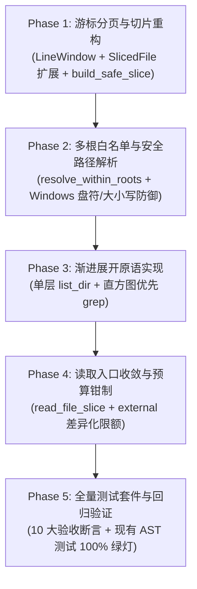

# Plan: Cursor Pagination, Progressive Code Exploration & Multi-Root Sandbox
# (代码探索器游标分页、渐进式展开与多工作区协同架构蓝图)

> **版本**: v1.30-proposal / Architecture Roadmap & Implementation Blueprint  
> **状态**: ✔️ Completed / 已实施归档（全量断言通过并归档于 2026-11-10_v1_30_batch1_cursor_pagination_and_progressive_code_exploration.md）  
> **涉及核心模块**: `plugins/quench-dev-tasks/server/code_explorer.py`  
> **关联治理不变量**: `INV-4` (Stdio 纯净度), `INV-6` (Review 只读性), `INV-8` (上下文配额防 DoS)  

---

## 1. 背景与核心问题复盘

Quorch 原生的 `code_explorer.py` 为代码上下文提取与 AST 符号探查提供了重要基础设施。但在面对复杂多模块项目（例如典型的创意工程环境：`stable-diffusion/lora/` 作为主工作区，偶尔需要查阅兄弟目录 `stable-diffusion/comfyui/` 的节点与模型定义），以及排查大型日志或长文件时，暴露出以下三大结构性瓶颈：

### 1.1 静态折叠与截断导致数据“静默丢失”
* **现状代码** (`code_explorer.py:220-235`):
  ```python
  if len(lines) > max_lines:
      slice_lines.extend(lines[:20])
      slice_lines.append("# ... [中间细节折叠，共 N 行，以下为核心接口声明] ...")
      # ... 拼接部分符号签名 ...
      slice_lines.append("# ... [切片行数超限截断] ...")
  ```
* **根本缺陷**：将源码中间细节替换为折叠标记后，**系统没有任何 API 能将中间被折叠的内容读取回来**。`truncated=True` 仅告知调用方“内容不全”，却不提供任何续读游标或路径。模型误以为自己看到了全貌，极易引发灾难性的因果误判。

### 1.2 缺少轻量级的渐进式展开原语（Progressive Disclosure）
* **根本缺陷**：单文件读取受 `MAX_FILE_BYTES = 512KB` 约束。面对未知的深层目录或数万行的日志/配置，缺乏“先地貌后细节”的探查工具。调用方要么直接盲读大文件触发跳过（`SkippedFile`），要么一次性吃满上下文配额。

### 1.3 单一工作区限制阻断多子模块协同
* **现状代码** (`code_explorer.py:93-125`):
  ```python
  os.path.commonpath([ws_real, target_real]) == ws_real
  ```
* **根本缺陷**：路径安全检查严格限制在单个 `workspace_root` 内。当会话锚定在 `stable-diffusion/lora/` 时，合法的跨兄弟目录只读访问（如 `../comfyui/custom_nodes/`）会被物理拦截为 `UnsafePathError`。

---

## 2. 核心架构不变量与设计准则

### 2.1 统一截断契约不变量 (Truncation Envelope Invariant)
所有文件读取与切片响应必须严格满足以下数学不变量：
$$\text{TruncationEnvelope} := (\text{content}, \{\text{start\_line}, \text{end\_line}, \text{total\_lines}, \text{next\_offset}\}, \text{origin})$$

* **不变量 I1 (续读权威性)**：`next_offset is not None` $\iff$ 之后仍有未返回内容，且 `next_offset` 可直接作为下一次调用的 `offset`。
* **不变量 I2 (完备性覆盖)**：`next_offset is None` $\implies$ 内容已完整覆盖至文件末尾（或单行字节超限已显式标记）。
* **不变量 I3 (无静默折叠)**：全链路严禁出现无续读路径的模糊省略标记（彻底移除 `[中间细节折叠]` 与 `[切片行数超限截断]`）。
* **核心验收准则（拼接等价性，No Gap, No Overlap）**：
  $$\text{page}(0, 100) + \text{page}(100, 100) + \text{page}(200, 100) \equiv \text{原文全部 250 行}$$

### 2.2 无状态预算差原则（替代脆弱的会话状态机）
* **反过度工程**：`code_explorer.py` 作为纯函数服务模块，绝不引入跨调用的全局可变字典或会话状态机（在 MCP 多进程或并发客户端下极易导致内存泄漏与状态串味）。
* **无状态预算钳制**：
  * **主工作区（内环，`origin="workspace"`）**：单次默认提取 100 行（`MAX_SLICE_LINES`），上限 512KB；
  * **关联目录（外环，`origin="external"`）**：单次硬钳制为 40 行（`RING1_MAX_LINES`），上限 64KB；超限响应在 Manifest 中附带提示（`[EXTERNAL] 建议先使用 grep(pattern) 定位关键行`），既避免外部盲读撑爆上下文，又保留 `next_offset` 保证可续读性。

### 2.3 路径安全与多根白名单注入原则
* `allowed_roots` **只允许由服务端/宿主环境配置显式注入**，严禁直接透传外部调用模型的入参，杜绝沙箱逃逸；
* 每一个候选根独立执行：盘符根拒绝（拒绝 `C:\` 或 `/`）+ `realpath` 解析 + `os.path.normcase` 大小写归一化（防御 Windows 大小写不敏感误拒）。

---

## 3. 架构接口与数据结构规范

### 3.1 模块级常量定义 (`code_explorer.py`)
```python
# 新增渐进式展开与外环预算常量
RING1_MAX_LINES = 40          # 外环（非主工作区）单次读取硬上限（行）
RING1_MAX_BYTES = 64 * 1024   # 外环单次读取硬上限（字节，64 KiB）
MAX_LIST_ENTRIES = 200        # 单次目录列表最大条目数
MAX_GREP_HITS = 200           # grep 全局最大命中行数
MAX_GREP_HITS_PER_FILE = 5    # grep 单文件最大匹配行数（保证广度）
MAX_GREP_PATTERN_CHARS = 200  # 正则表达式最大长度限制（防 ReDoS）
```

### 3.2 数据结构向后兼容扩展

#### `SlicedFile` 追加字段
```python
@dataclass(frozen=True)
class SlicedFile:
    rel_path: str
    language: str
    symbols: List[SymbolIface]
    slice_text: str
    truncated: bool = False
    size_bytes: int = 0
    # --- 新增游标与来源字段（末尾追加，全带默认值，保持向后兼容）---
    start_line: int = 1                    # 1-based，含起始行
    end_line: int = 0                      # 1-based，含结束行；0 表示空文件
    total_lines: int = 0                   # 文件的真实物理总行数
    next_offset: Optional[int] = None      # 续读时的 offset 参数；None 表示到底
    origin: str = "workspace"              # "workspace" | "external"
```

#### 新增行窗口纯函数数据结构 `LineWindow`
```python
@dataclass(frozen=True)
class LineWindow:
    text: str
    start_line: int
    end_line: int
    total_lines: int
    next_offset: Optional[int]
    byte_capped: bool
```

#### 新增渐进式展开数据结构
```python
@dataclass(frozen=True)
class DirEntryInfo:
    name: str
    kind: str          # "dir" | "file"
    size_bytes: int = 0

@dataclass(frozen=True)
class DirListing:
    rel_path: str
    origin: str        # "workspace" | "external"
    entries: List[DirEntryInfo]
    total_entries: int
    omitted: int

@dataclass(frozen=True)
class GrepFileHit:
    rel_path: str
    count: int

@dataclass(frozen=True)
class GrepLineMatch:
    rel_path: str
    lineno: int
    text: str

@dataclass(frozen=True)
class GrepResult:
    pattern: str
    files_scanned: int
    histogram: List[GrepFileHit]      # 按命中数降序排列的文件清单
    matches: List[GrepLineMatch]      # 具体匹配行（每文件 ≤5 行，全局 ≤200 行）
    truncated: bool
    elapsed_ms: int
```

---

## 4. 核心原语设计与实现规范

### 4.1 行窗口构造纯函数 `build_line_window`
```python
def build_line_window(
    source_text: str,
    offset: int = 0,
    limit: int = MAX_SLICE_LINES,
    max_bytes: int = MAX_FILE_BYTES,
) -> LineWindow:
    """无 I/O 的纯函数，计算文本切片、行游标与字节预算边界。
    
    行为契约：
    1. offset < 0 自动视作 0；limit <= 0 自动视作 1；
    2. offset >= total_lines 时返回 text=""、next_offset=None，不抛出异常；
    3. 逐行累加，文本字节超过 max_bytes 即停，返回 next_offset = offset + consumed_lines；
    4. 若单行单独超过 max_bytes（如压缩代码），截断该行字符并追加安全提示，
       强制 next_offset = offset + 1，杜绝翻页死循环。
    """
```

### 4.2 现有函数改造 `build_safe_slice` (保持签名兼容)
```python
def build_safe_slice(
    source_text: str,
    symbols: List[SymbolIface],
    max_lines: int = MAX_SLICE_LINES,
) -> Tuple[str, bool]:
    """保留旧接口签名，底层完全替换为 build_line_window 分页，废除折叠丢失。"""
    w = build_line_window(source_text, offset=0, limit=max_lines)
    return w.text, w.next_offset is not None
```

### 4.3 多根安全路径解析 `resolve_within_roots` 与 `is_path_safe`
```python
def resolve_within_roots(
    workspace_root: str,
    target_path: str,
    allowed_roots: Optional[Sequence[str]] = None,
) -> Optional[Tuple[str, str]]:
    """验证目标路径是否位于 workspace_root 或任一 allowed_roots 中。
    返回 (matched_root_real, target_real) 或 None。
    
    防御规则：
    1. 防空字符注入 (\x00)；
    2. 检查并拒绝 Windows 保留设备名 (CON, PRN, AUX, NUL, COM1-9, LPT1-9)；
    3. 严格拒绝根目录与驱动器盘符 (如 C:\ 或 /)；
    4. 使用 os.path.realpath 解析符号链接，防御符号链接逃逸；
    5. 使用 os.path.normcase 规范化路径大小写，防御 Windows 大小写误拒；
    6. 捕获 cross-drive commonpath 抛出的 ValueError 并返回 None。
    """

def is_path_safe(
    workspace_root: str,
    target_path: str,
    allowed_roots: Optional[Sequence[str]] = None,
) -> bool:
    """保留既有函数签名，作为 resolve_within_roots 的薄封装。"""
    return resolve_within_roots(workspace_root, target_path, allowed_roots) is not None
```

### 4.4 统一读取入口 `read_file_slice`
```python
def read_file_slice(
    workspace_root: str,
    rel_path: str,
    offset: int = 0,
    limit: Optional[int] = None,
    allowed_roots: Optional[Sequence[str]] = None,
) -> SlicedFile:
    """读取文件切片的唯一收敛入口。
    
    执行顺序：
    1. resolve_within_roots 解析并校验路径安全；
    2. is_sensitive_file 对解析后的 realpath 执行敏感文件过滤；
    3. 推导 origin: 若 normcase(matched_root) == normcase(workspace_root) 为 "workspace"，否则为 "external"；
    4. 无状态预算钳制：
       - workspace: effective_limit = min(limit or 100, 100), max_bytes = 512KB
       - external:  effective_limit = min(limit or 40, 40),   max_bytes = 64KB
    5. 校验文件存在性与二进制文件过滤；
    6. 读取内容并调用 build_line_window；
    7. 组装并返回 SlicedFile。
    """
```

### 4.5 渐进展开原语 `list_dir` 与 `grep`
```python
def list_dir(
    workspace_root: str,
    rel_path: str = ".",
    allowed_roots: Optional[Sequence[str]] = None,
    max_entries: int = MAX_LIST_ENTRIES,
) -> DirListing:
    """严格单层 scandir，过滤 .git / node_modules / __pycache__。
    目录优先、名称字典序升序。超限返回 omitted 计数，永不返回空。"""

def grep(
    workspace_root: str,
    pattern: str,
    rel_path: str = ".",
    allowed_roots: Optional[Sequence[str]] = None,
    max_files: int = MAX_EXPLORE_FILES,
    deadline: float = DEFAULT_DEADLINE_SECONDS,
) -> GrepResult:
    """纯 Python 正则检索。
    1. 校验 pattern 长度 ≤ 200 并预编译（失败抛出 CodeExplorerError）；
    2. 遍历指定子树，严格按 DEFAULT_DEADLINE_SECONDS (3.0s) 逐文件检查超时；
    3. 流式按行扫描，先生成按命中数降序排列的 histogram，再填充 matches（每文件最多留 5 行）；
    4. 命中行达到 MAX_GREP_HITS (200) 即停并标记 truncated=True。"""
```

---

## 5. 分阶段实施规划与原子任务拆解



### Phase 1: 游标分页与切片重构 (Cursor Pagination)
1. 在 `code_explorer.py` 常量区追加 `RING1_MAX_LINES` 等常量；
2. 在 `SlicedFile` 追加 `start_line`, `end_line`, `total_lines`, `next_offset`, `origin`（全默认值）；
3. 实现 `LineWindow` 与 `build_line_window` 纯函数；
4. 改造 `build_safe_slice`，删除折叠文本，委托至 `build_line_window`。

### Phase 2: 多根白名单与安全路径解析 (Multi-Root Sandbox)
1. 实现 `resolve_within_roots`，支持 `allowed_roots: Optional[Sequence[str]] = None`；
2. 强化 Windows 路径防御：`os.path.normcase` 与驱动器根检测；
3. 将 `is_path_safe` 改写为调用 `resolve_within_roots` 的薄封装。

### Phase 3: 渐进展开原语实现 (Progressive Primitives)
1. 实现 `list_dir` 单层目录遍历；
2. 实现 `grep` 正则检索，包含 pattern 长度校验与 3.0s 严格超时中断。

### Phase 4: 读取入口收敛与预算钳制 (Read Convergence)
1. 实现 `read_file_slice`，集中完成路径解析、敏感过滤、环形预算钳制；
2. 替换 `explore_code_slices` 内部的原生 `open()` 读取分支。

### Phase 5: 测试套件与回归验证 (Verification & DoD)
* 编写测试文件 `tests/test_code_explorer_cursor_and_progressive.py`，完整覆盖 10 大验收断言。

---

## 6. 核心验收检查清单 (Acceptance Checks)

| 用例 ID | 测试目标与断言 | 验证手段 |
|---|---|---|
| **A-1** | 250 行文件，`offset=0, limit=100` $\to$ `start_line=1, end_line=100, total_lines=250, next_offset=100` | 单元测试 |
| **A-2** | **核心不变量（无空洞无重叠）**：`page(0, 100) + page(100, 100) + page(200, 100)` 逐行拼接完全等于原文全部 250 行 | 单元测试 |
| **A-3** | 单行超大文件（10 万字符），`max_bytes=1000` $\to$ `byte_capped=True` 且 `next_offset == offset + 1`（杜绝翻页死循环） | 单元测试 |
| **A-4** | `offset >= total_lines` $\to$ 返回 `text=""`, `next_offset=None`，不抛出异常 | 单元测试 |
| **A-5** | 多根白名单矩阵：跨根未指定时返回 `False`；列入 `allowed_roots` 时返回 `True`；`allowed_roots=['C:/']` 恒返回 `False` | 单元测试 |
| **A-6** | 符号链接逃逸防御：在根内建立指向根外的目录符号链接 $\to$ 目标路径仍被严格判定为 `False` | 单元测试 |
| **A-7** | `build_safe_slice` 保持现有 `Tuple[str, bool]` 返回，且不再包含 `[中间细节折叠]` | `rg` 检查 + 单测 |
| **A-8** | `list_dir` 对 500 条目目录 $\to$ `len(entries)==200, omitted==300`；对文件路径抛出 `CodeExplorerError` | 单元测试 |
| **A-9** | `grep` 验证：非法正则抛出 `CodeExplorerError`；7 处命中的文件 $\to$ `histogram[0].count==7` 且 `matches` 长度限 5 行；`deadline=0` 立即返回 `truncated=True` | 单元测试 |
| **A-10** | 外环读取钳制：对跨根文件读取，`limit` 强制被钳制为 40 行，`origin=="external"` | 单元测试 |

---

## 7. 明确不做的事项 (Out of Scope & Anti-Over-Engineering)

1. **坚决不做跨调用的硬门禁状态机**：不强制“必须先 list/grep 才能 read”。依赖无状态差异化预算（内环 100 行 / 外环 40 行）与 `next_offset` 游标引导自发收敛；
2. **坚决不向外部模型入参暴露 `ring` 或 `allowed_roots` 参数**：所有权限与多根列表由服务端配置注入，环形分类由路径相对关系自动推导；
3. **坚决不引入外部命令行依赖（如 ripgrep 二进制）**：纯 Python 标准库实现，确保跨平台与单机环境零配置开箱即用；
4. **不改动 Quorch 原有的 AST 符号提取与 `MAX_HOPS_LIMIT` 逻辑**：保持 MES 严管管线（管线 A）的既有分析能力 100% 稳定运行。
