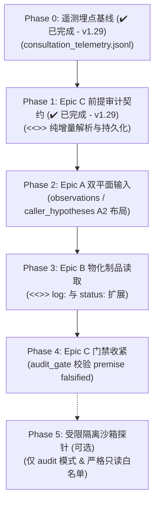

# Plan: Reviewer Anti-Anchoring & Runtime Verification Architecture
# (Reviewer 防锚定与运行时反向探针治理蓝图)

> **版本**: v1.29-approved / Architecture Roadmap & Implementation Blueprint  
> **状态**: ✅ Approved Roadmap / 已通过评审（经外部 Reviewer 模型审查仲裁）  
> **上下文与触发场景**:  
> Quorch 最初是为辅助精密制造执行系统（MES）开发而设计的治理框架。但在多 Agent 协同演化中，发现主 Agent（敏捷执行模型，如轻量级快速模型）在向评审模型（Reviewer）或外部推理引擎咨询时，存在普遍的“事实-推断坍缩”与“预设性提问注入”。  
> 本规划经外部架构评审（Reviewer）深度论证与多轮推演，明确了核心治理不变量（INV-4、INV-6、INV-8）的保护与正交解耦方案，并为 Quorch 确立了分阶段演进实施路线。

---

## 1. 核心治理不变量与威胁模型边界

在引入运行时验证与反锚定能力的同时，Quorch 必须无条件捍卫其核心架构不变量，绝不以牺牲系统底层稳定性为代价换取功能灵活性：

| 不变量 | 治理判定 | 历史威胁模型与演化设计 |
|---|---|---|
| **INV-4 (Stdio 纯净度)** | **绝对保留，零放宽** | FastMCP JSON-RPC 协议帧物理基石。任何探针或外部库的未受控 `print()` 都会切碎数据帧导致 IDE 会话不可逆失联。**探针数据必须严格走专用证据文件/日志侧信道，stdout 神圣不可侵犯**。 |
| **INV-6 (Review 只读)** | **保留，细化动作分级** | 防止审查模型“顺手修复代码”造成自证偏见、基线破坏和写权并发冲突。明确**“只读 ≠ 零执行”**：<br>1. **纯观察**（读文件、AST 切片、diff）✅ 允许；<br>2. **观察性执行**（只读 subprocess、白名单探针，前后比对快照指纹）✅ 允许；<br>3. **副作用写入**（修改受管源码）❌ 绝对禁止。 |
| **INV-8 (上下文配额)** | **保留框架，演化为双平面** | 防范成本 DoS 与长上下文退化（大量日志淹没关键业务边界缺陷）。从扁平化 40k 拆分为**静态源码切片配额（40k）**与**运行时证据独立配额（20k，且经结构化压缩）**，两平面正交计价、独立熔断。 |

> **关键澄清：关于“证据控制权倒置”**  
> 原蓝图将“由 Runner 挑选上下文”视为缺陷，经评审纠偏确认：这是保护 INV-6 与 INV-8 的**刻意防御设计**。若赋予 Reviewer 自主遍历磁盘权，将破坏沙箱边界。正确的解法是**使“未被审查的承重假定”具备显式可审计性（即 Epic C 翻转条件）**，而非颠倒文件挂载权限。

---

## 2. 软件工程 (MES) vs 探索性场景的认知失效差异

### 2.1 为什么 MES 等经典开发场景中，锚定效应的破坏性相对受控？
1. **客观物理底线的自动化证伪（Deterministic Hard Constraints）**：编译器、静态类型、Pytest 单测、数据库唯一性索引构成硬裁判，执行失败强行中断错误链条。
2. **状态机与规则高度收敛（Bounded State Space）**：工单排产、质检放行、物料批次流转具有明确的真值表。
3. **Quorch 硬性管控制约**：`DoD Verification Commands` 强制所有任务单附带可执行验证命令，未全绿无法流转关闭。

### 2.2 MES 场景中依然存在的隐蔽锚定风险（不可盲目乐观）
1. **高并发与竞争条件（Concurrency & Race Conditions）**：Reviewer 轻信主 Agent“单线程顺序写入”的假定，在车间多 PLC 瞬时并发时引发死锁或覆盖。
2. **业务逻辑漂移与隐性假设违背（Spec Erosion）**：跨站点的物料批次守恒或离线重传幂等机制被局部简化，Reviewer 单文件审查未能觉察。
3. **过拟合单测（Test Cheating / Confirmation Bias）**：测试用例围绕主 Agent 自身错误理解编写，自圆其说。

---

## 3. Quorch Reviewer 机制现状的结构性盲区复盘

勘查当前 Quorch 源码（`server.py`、`consultation.py`、`reviewer_engine.py`），现有机制在防锚定层面存在以下四大瓶颈：

```
主 Agent (Runner)                      Quorch 服务端                       Reviewer 模型
┌──────────────────┐               ┌──────────────────┐               ┌──────────────────┐
│ 产生主观推断       │ ── query ──► │  直接拼装提示词   │ ── prompt ──► │ 接纳为既定事实    │
│ "已确认微调导致.." │  (单字段)    │ 无事实推断隔离     │               │ 编织自洽论证      │
└──────────────────┘               └──────────────────┘               └──────────────────┘
                                             │                                  │
                                             │ ◄─── <<<NEED-FILES>>> (静态补全) ─┘
                                             ▼
                                  从磁盘抓取更多代码切片
                                  (无运行时证据 / 无法执行探针)
```

1. **入口无解耦契约**：`dev_reviewer_submit` 的入参仅有单一 `query: str`，直接拼入 Prompt，事实与推断信道坍缩。
2. **`<<<NEED-FILES>>>` 局限于代码切片**：无法获取由测试或运行时产生的物化遥测数据。
3. **多跳门控冷启动（Gate Skip）**：`evaluate_multi_hop_gate` 要求历史 `>=20` 条样本且 `demand>30%` 才放行多跳，冷启动阶段多跳静态补全会被熔断。
4. **结论缺乏证伪契约**：Reviewer 的输出 `findings` 为自由文本，未显式声明其结论依赖的边界假定与证伪翻转条件。

---

## 4. 演进路线图与分阶段实施规划 (Phased Roadmap)

经评审仲裁，实施顺序由原设想的 A → B → C 修正为**按风险递增、数据先行的 Phase 0 ~ Phase 5 渐进路线**：



### Phase 0: 咨询遥测基线 (Consultation Telemetry Baseline) (✔️ 已完成 - v1.29)
- **目标**：为后续门控与配额提供客观数据依据。
- **改动**：新增 `consultation_telemetry.jsonl` sink，逐次记录调用中的字段分布、前缀长度、耗时与判决状态。零破坏性变更。
- **交付状态**：已由任务 29.1 交付，落盘于 `.agents/logs/telemetry/consultation_telemetry.jsonl`，具备跨进程文件锁 `FileConsultationTelemetrySink`、Fail-Open 精准异常捕获与 GC 免疫。

### Phase 1: Epic C 前提审计输出契约 (Structured Premises Contract) (✔️ 已完成 - v1.29)
- **目标**：规范 Reviewer 审查输出，强制将承重假设结构化。
- **改动**：
  - 约定输出语法定界符：
    ```text
    <<<PREMISES>>>
    premise: "单实例部署，无多节点共享内存"
    flip_condition: "配置中出现集群负载均衡"
    falsifiable: true
    <<<END>>>
    ```
  - 新增 `PremiseRecord` dataclass 与 `parse_premises()` 纯函数解析器；
  - 结果计入遥测记录与 `verdicts.jsonl`；解析失败降级记录 stderr，不阻断流程；
  - 建立严格覆盖矩阵：2048/2049 悬崖双锚、覆写优先级高于 token、三布尔 presence 8 组合、Windows 句柄回收防御。
- **交付状态**：已由任务 29.1 交付，单测 `test_premises_parsing.py` (12 passed) 与 `test_consultation_telemetry.py` (19 passed) 全量绿灯。

### Phase 2: Epic A 输入双平面解耦 (Epistemic Input Plane A2 Layout)
- **目标**：解耦主 Agent 事实输入与推测假说，同时保证 Prompt Cache 极高命中率。
- **改动**：
  - `dev_reviewer_submit` 与 `dev_tasks_refine_spec` 增加可选入参 `observations: str | None = None`、`caller_hypotheses: str | None = None`；
  - **A2 尾置布局**：在静态系统前缀（含工作区文件树与模式锚点）后、`<<<NEED-FILES>>>` 之前插入动态双平面块，保持前缀哈希一致；
  - 纳入 `HopBudget` 统一配额（各限 16,000 字符）。

### Phase 3: Epic B 物化制品只读读取 (Materialized Artifact Reads)
- **目标**：在零进程执行风险下，为 Reviewer 提供运行时物理证据。
- **改动**：
  - 扩展 `<<<NEED-FILES>>>` 语法，支持提取 Runner 已物化的测试日志与退出状态：
    ```text
    <<<NEED-FILES>>>
    docs/dev_tasks/task.md:40-90
    log:tests/.last_run.log:tail:400
    status:tests/.last_junit.xml
    <<<END>>>
    ```
  - 调优多跳门控：将 `MIN_TELEMETRY_SAMPLES`（原硬编码 20）开放为配置项（如默认降为 8），并支持工作区首查快速通道（first-consult fast path）。

### Phase 4: Epic C 门禁收紧与翻转核查 (Audit Gate Enforcement)
- **目标**：让前提假定在任务流转中产生约束力。
- **改动**：
  - 在 `.agents/quench_stack.yaml` 引入 `audit_gate.require_premise_audit: false`（默认关闭）；
  - 开启后，若 review 记录中存在 `falsifiable: true` 且存在反向证据，触发任务确认阻断。

### Phase 5: 隔离受限探针执行器 (Guarded Sandbox Probe Supervisor, 可选)
- **目标**：在深层架构排障（`audit` 模式）下提供受控探针。
- **改动**：基于 `quench_stack.yaml` 的命令白名单与专用子进程 supervisor（`probe_runner.py`），在隔离快照目录中受限运行，执行前后严格比对工作区指纹，产生任何写修改一律 fail-closed 阻断。
