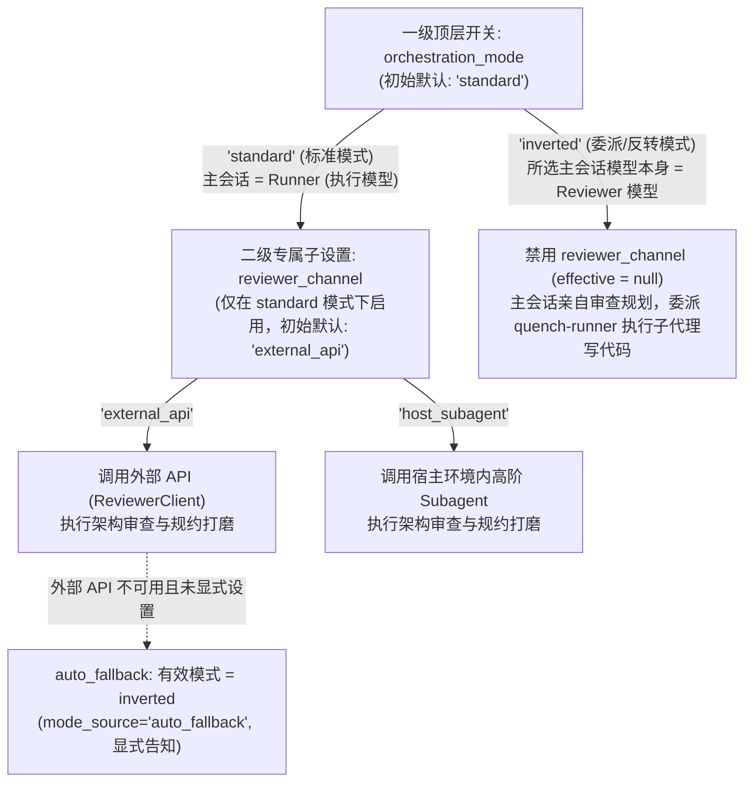
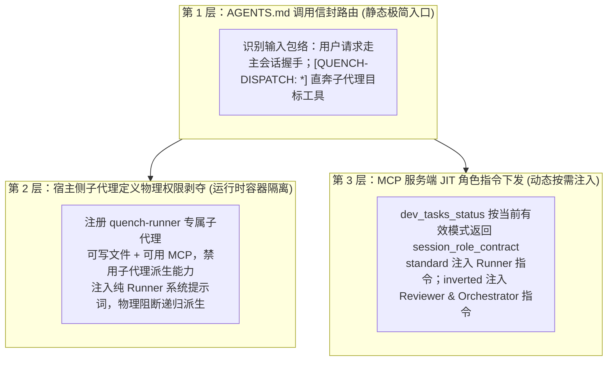
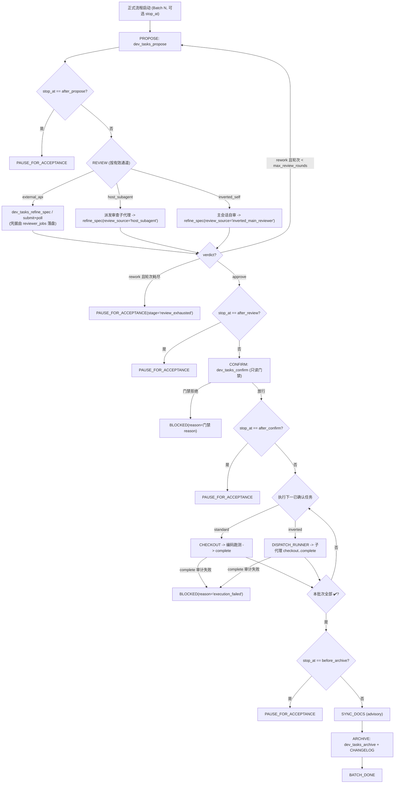

# Quench Dev-Orchestrator v1.25 双模编排拓扑、精益契约与全自动闭环工作流护栏 (Autopilot Harness) 路线图
> *(Dual-Mode Orchestration Topology, Lean Specification Contract & Batch Autopilot Workflow Harness Roadmap)*

> **Document Type**: Milestone Roadmap (Sub-charter for v1.25)  
> **Status**: 🟡 ACTIVE (In Planning / Architecture Finalized — Rev.2)  
> **Preceding Milestone**: [v1.24 原生心跳自刷新、长轮询降压与 Poll 极简瘦身路线图](./archive/v1.24_mcp_progress_heartbeat_and_poll_slimming_roadmap.md) (🟢 COMPLETED)  
> **Deferred Blueprint**: [Reviewer 轮询硬契约、状态栏扩展与跨宿主端侧可观测性蓝图](./plan_reviewer_polling_contract_and_cross_host_statusbar.md) (📋 PENDING)  
> **Scope**:
> 1. **双模编排与层级持久化切换（Epic 1）**：支持顶层编排模式 `standard`（标准模式：主会话敏捷执行 + 独立 Reviewer 审查）与 `inverted`（委派/反转模式：所选主会话模型本身即为 Reviewer 模型 + 宿主轻量 Subagent 执行）持久化切换；在 `standard` 模式下提供专属子设置 `reviewer_channel`（`external_api` 外部 API vs `host_subagent` 环境内高阶 Subagent，在 `inverted` 模式下不启用）；初始固定默认为 `standard` + `external_api`，无外部 API 时**显式可见地**自动回退 `inverted`（`mode_source="auto_fallback"`）；支持用户通过自然语言指令触发持久化切换（`.agents/.quench_runtime_mode.json`）。
> 2. **三层上下文隔离与双层代码探查（Epic 2）**：统一确立“仅主会话调用 `dev_tasks_status`，所有 Subagent（无论执行、审查、探路）一律免调”铁律；通过调用信封路由、宿主侧子代理定义（物理剥夺 `quench-runner` 递归派生权）与 MCP JIT 角色提示词下沉实现共用 `AGENTS.md` 下的第 0 秒隔离；收敛并取代未落地的 `QUENCH_ROLE` 双入口方案；固化 `inverted` 模式下“轻量 `research` 广度探路 + 主会话按行号切片精读”双层探查范式。
> 3. **精益任务单契约与审查边界重塑（Epic 3）**：收敛为单一统一六字段规范，精准摘除提示词与工具描述中诱发过度设计的“无上限防御（No Upper Bounds）”与“无差别点名并发死锁/离线降级”指令，确立按上下文复杂度对齐原则；代码片段“免写样板、写了即用”，免除事后校验器对步骤长度或代码块的教条拦截。
> 4. **统一审查凭据通道（Epic 4）**：为 `external_api` / `host_subagent` / `inverted` 三类审查来源建立统一的 `verdicts.jsonl` 凭据落盘路径（`source` 字段区分），由 `audit_gate.accepted_sources` 策略决定接受范围；`auto_fallback` 状态下的自签凭据永不被门禁接受。
> 5. **分批次 Autopilot 闭环工作流护栏与断点控制（Epic 5）**：在 MCP 工具链返回报文中内置由**任务单状态纯函数推导**的 `harness_next_action` 状态机接力棒，进入正式流程后按批次自动闭环执行 `Propose -> Review -> Confirm -> Execute (Checkout..Complete) -> Sync Docs (advisory) -> Archive`，并支持用户通过一次性 `stop_at` 断点在任意阶段停靠验收。  
> **Explicit Non-Scope**: 破坏 16-tool 工具面数量不变量（严禁新增独立 MCP 工具，所有参数与状态均内聚于既有 `dev_tasks_*` 工具面）、在核心模块中硬编码任何模型名称 / 宿主专属工具名 / 模型档位枚举，或基于 `EFFORT LEVEL` 的隐式模型嗅探（严守 INV-5 厂商与模型中立）。  
> **Authority**: 遵循 v1.20 核心不可触碰清单与九大核心不变量（INV-1 ~ INV-9）；本文件为 v1.25 唯一路线图 SSOT。

---

## 0. 背景、痛点与演进动因（Verdict & Motivation）

在实际多模型协同开发中，开发者面临宿主能力边界、套餐额度调配与重复提示词心智负担三重挑战：

1. **宿主 Subagent 唤起方向的不对称性**：
   以 Antigravity 宿主为例（下文模型名均为**宿主侧示例**，不进入任何核心模块），其子代理唤起接口仅暴露有限的模型档位枚举。当以轻量敏捷模型（如 `3.8 Flash`）作为主会话时，无法在宿主内部向上唤起旗舰架构模型（如 `4 Argon`）作为 Reviewer Subagent；若要同时使用宿主套餐内的旗舰模型（做架构审查）与轻量模型（做代码执行），且避免手动切会话/切模型造成的缓存失效，必须支持将主从拓扑翻转——**由旗舰模型坐镇主会话担任 Reviewer & Orchestrator，向下唤起宿主轻量档位作为执行 Subagent**。
2. **套餐额度与外部 API 的灵活调配诉求**：
   开发者常根据套餐内高阶模型余量在“标准模式（轻量主会话 + 外部 API 审查）”与“委派模式（旗舰主会话 + 轻量子代理执行）”之间切换；同时未来宿主可能开放从轻量模型直接唤起环境内高阶模型作为 Reviewer Subagent。系统需提供**零隐式猜测、确定性初始默认、且可通过一句话持久化切换**的双维开关。
3. **Reviewer 模型的“过度设计”倾向**：
   现有 [`dev-tasks-review/SKILL.md`](../../plugins/quench-dev-tasks/skills/dev-tasks-review/SKILL.md)（L39 `★ Rigidly Enforced, No Upper Bounds`）、[`reviewer_engine.py`](../../plugins/quench-dev-tasks/server/reviewer_engine.py)（L1181 / L1226 无差别要求排查并发死锁与离线降级）、[`server.py`](../../plugins/quench-dev-tasks/server/server.py)（L2210 `dev_tasks_refine_spec` 工具描述 `concurrency boundary defenses`、L2332 `ironclad`）存在强诱导措辞，导致模型为简单改动凭空捏造并发锁、兜底分支与长篇样板代码。
4. **重复流程提示词的机械劳动**：
   在路线图敲定进入正式开发后，开发者往往需要在每轮提示词中重复手写*“生成任务单 -> 调 Reviewer 评估 -> 放行后确认 -> 执行开发 -> 更新相关文件并归档”*。由于现有 MCP 工具仅返回静态成功消息而非状态机下一步接力指令，模型每走一步就会停机等待，亟需内建 **Autopilot Workflow Harness（状态机接力棒护栏）**。

### 0.1 信任模型声明（Trust Model）

延续 [`dev-tasks-workflow/SKILL.md`](../../plugins/quench-dev-tasks/skills/dev-tasks-workflow/SKILL.md) §6 的既有声明：角色声明与审查凭据属于**协作便利与操作卫生契约，而非对抗性安全边界**。MCP 服务端无法识别调用方具体是哪个模型，因此：

| 状态来源 | 责任归属 | 服务端行为 |
| :--- | :--- | :--- |
| **用户显式切换**（`mode_source="explicit"`） | 用户自行约束：用户声明“当前主会话模型足以担任 Reviewer” | 信任该声明，自签凭据按 `audit_gate.accepted_sources` 策略接受 |
| **系统自动回退**（`mode_source="auto_fallback"`） | 用户**未作任何声明**，系统不得代为声明 | 允许零配置继续工作，但须显式告知；自签凭据**永不**满足已启用的 `audit_gate` |

> 💡 由于 `AuditGatePolicy.enabled` 默认为 `False`，**未配置 API、也未主动启用审计门禁的零配置用户在回退后可全程无感使用**；只有主动启用了 `audit_gate` 的用户，才会在回退态下被要求“一句话显式切换”或配置外部 API——这正是他们启用门禁所期望的行为。

---

## 1. Epic 1：双模编排拓扑与主从层级持久化切换（Dual-Mode Orchestration & Hierarchical Persistent Toggles）

### 1.1 顶层编排模式与 `standard` 专属审查通道（主从层级结构）

摒弃任何复杂的“未锁定初始猜测”或破坏 `INV-5` 的模型特征嗅探，采用**“一级编排模式 + 标准模式专属二级审查通道”**的清晰主从层级结构：



| 层级与归属 | 配置/状态键 | 可选枚举值 | 初始默认值 | 激活条件与语义定义 |
| :--- | :--- | :--- | :---: | :--- |
| **一级开关：主从编排模式** | `orchestration_mode` | `"standard"` \| `"inverted"` | **`"standard"`** | **全局生效**：<br>• **`standard`（标准模式）**：主会话模型担任 **Runner（敏捷执行者）**；架构审查交由 `reviewer_channel` 指定的审查端完成，主会话直接调用 `dev_tasks_checkout` 编码跑测。<br>• **`inverted`（委派/反转模式）**：**用户在宿主中选择的主会话模型本身就是 Reviewer 模型**；主会话亲自负责架构把关与审查凭据提交（**不启用 `reviewer_channel`**），代码执行与测试委派给 `quench-runner` 执行子代理。 |
| **二级子设置：标准模式审查通道** | `reviewer_channel` | `"external_api"` \| `"host_subagent"` | **`"external_api"`** | **仅当 `orchestration_mode == "standard"` 时启用**（`inverted` 下返回 `effective_reviewer_channel = None`）：<br>• **`external_api`**：通过 `ReviewerClient` 调用外部 OpenAI 兼容 API（`dev_reviewer_submit` / `dev_reviewer_poll` / `dev_tasks_refine_spec`）。<br>• **`host_subagent`**：不调用外部 API，由主会话唤起宿主环境内高阶模型完成只读审查，审查结论经 `dev_tasks_refine_spec` 的凭据提交模式落盘（见 Epic 4）。 |
| **辅助键：执行子代理模型提示** | `runner_subagent_model_hint` | 任意字符串 \| `null` | **`null`** | 仅 `inverted` 生效：派单模板中执行子代理的模型档位提示，由用户按所在宿主自行填写（如宿主侧档位名）。为 `null` 时角色契约仅表述为“宿主可用的轻量执行档位”，**服务端核心模块不出现任何模型/档位字面量**。 |

> **无外部 API 时的可见自动回退（Visible Auto-Fallback on Missing External API）**：  
> 当运行时文件**不存在或未显式设置** `orchestration_mode`，且检测到外部 API 不可用（`reviewer_engine` provider 为空/`none`，或其 `api_key_env` 对应环境变量缺失）时，`dev_tasks_status` 在**读取时计算**有效模式为 `"inverted"`，并返回：
> ```json
> {"effective_mode": "inverted", "mode_source": "auto_fallback",
>  "fallback_notice": "未检测到外部 Reviewer API，已回退为委派模式：当前主会话模型将担任 Reviewer。如需固定此模式请说“切到委派模式”。"}
> ```
> - 回退结果**不写入**运行时文件（配置 API 后自动恢复 `standard`）；
> - `session_role_contract` 要求主会话在首次响应中向用户**一句话转述** `fallback_notice`（不阻塞、不需要用户回答）；
> - 回退态下 `stop_at` 有效默认值为 `after_review`（见 §5.2），自签凭据不满足已启用的 `audit_gate`（见 §4.2）。
> - 用户显式设置过的模式**永不**被自动回退覆盖：若显式 `standard + external_api` 而 API 不可用，`harness_next_action` 返回 `BLOCKED(reason="review_channel_unavailable")` 并提示用户切换。

### 1.2 用户输入驱动的跨会话持久化切换（`.agents/.quench_runtime_mode.json`）

1. **持久化状态文件**：`.agents/.quench_runtime_mode.json`（**由任务 25.2 将其加入 `.gitignore`**，不污染版本库）：
   ```json
   {
     "orchestration_mode": "standard",
     "reviewer_channel": "external_api",
     "runner_subagent_model_hint": null,
     "autopilot": {"task_file": null, "stop_at": "none", "consumed": false, "set_at": null},
     "updated_at": "2026-10-23T10:00:00Z"
   }
   ```
2. **优先级（Precedence）**：`运行时文件中的显式值` > `内置默认值（standard / external_api）`；`auto_fallback` 仅在“无显式值 ∧ 外部 API 不可用”时于读取时计算。v1.25 **不在** `quench_stack.yaml` 引入团队级编排基线（避免范围蔓延，留作后续）。
3. **`dev_tasks_status` 切换接口扩展**（不新增独立 MCP 工具，保持 16-tool 表面恒定）：
   - `switch_mode: Optional[Literal["standard", "inverted"]] = None`
   - `switch_reviewer_channel: Optional[Literal["external_api", "host_subagent"]] = None`（仅 `standard` 生效；在 `inverted` 下传入则返回校验错误）
   - `stop_at: Optional[Literal["none", "after_propose", "after_review", "after_confirm", "before_archive"]] = None`
4. **写语义约束（status 的“只读例外”）**：
   - `dev_tasks_status` **默认保持纯只读**；仅当传入任一 `switch_*` / `stop_at` 参数时才写入运行时文件，且只允许写该文件；返回报文附带 `runtime_mode_changed: true`。
   - 写入采用 `filelock(.quench_runtime_mode.json.lock)` + 临时文件 `os.replace` 原子替换；损坏/不可解析时按“无显式值”处理并在返回中给出 `runtime_mode_warning`，绝不抛异常阻断 status。
   - **在途保护**：存在 `🔨 执行中` 任务时拒绝 `switch_mode` / `switch_reviewer_channel`（返回 `reason="switch_denied_task_in_progress"`），防止执行中途角色翻转。
5. **生效时机**：切换对发起调用的会话**立即生效**（同次返回即为新模式的 `session_role_contract`）；其他并发会话在其下一次 `dev_tasks_status` 时生效（角色契约以 status 返回为准，不做跨会话推送）。
6. **交互体验**：用户说*“切到委派模式/反转模式”*、*“切回标准模式”*、*“审查切到环境内模型/外部 API”*时，主会话调用 `dev_tasks_status` 并传入对应参数；此后所有新建会话沿用该持久化状态，直至用户下次主动切换。

---

## 2. Epic 2：三层上下文隔离、主会话专属握手与双层代码探查（Context Isolation & Reconnaissance）

### 2.1 统一启动握手铁律：仅主会话调用 `dev_tasks_status`

无论当前运行在 `standard` 还是 `inverted` 模式，**`dev_tasks_status` 严格限定为主会话（Main Session）专属的启动握手工具**；任何被宿主子代理机制唤起的子代理一律免调 `dev_tasks_status`：

| 会话/代理类型 | 输入消息包络特征 | 启动首步行为 | 是否调用 `dev_tasks_status` |
| :--- | :--- | :--- | :---: |
| **主会话 (Main Session)** | 接收人类用户请求 | 会话启动或正式流程开启时调用 `dev_tasks_status`，获取队列状态、当前模式身份卡（`session_role_contract`）与 `harness_next_action` | **✅ 必须调用** |
| **执行子代理 (`quench-runner`)** | 首条消息含 `[QUENCH-DISPATCH: RUNNER]` | 直接按派单指定的 `task_file` 与 `task_id` 调用 `dev_tasks_checkout` -> 编码跑测 -> `dev_tasks_complete` -> 返回 ≤5 行 C3 交付卡 | **❌ 严禁调用** |
| **审查子代理 (`reviewer`)** | 首条消息含 `[QUENCH-DISPATCH: REVIEWER]` | 直接针对派单传入的任务草案与代码切片执行只读审查，返回六字段规约与 `approve` / `rework` 结论（由主会话负责提交凭据） | **❌ 严禁调用** |
| **探路子代理 (`research`)** | 首条消息含 `[QUENCH-DISPATCH: RESEARCH]` | 直接执行检索与只读文件读取，返回高密度符号与行号索引 | **❌ 严禁调用** |

### 2.2 共用 `AGENTS.md` 下的三层第 0 秒提示词隔离

为彻底解决主从模型共用同一份 [`AGENTS.md`](../../AGENTS.md) 时的角色串戏问题（避免 `inverted` 主会话误调 `checkout` 自己写代码，或子代理递归派生子代理），实施三层隔离：



- **宿主中立分层**：服务端 `session_role_contract` 仅使用抽象动词（如“派发执行子代理”“派发审查子代理”）与 `runner_subagent_model_hint`；宿主专属工具名与参数（如 Antigravity 的 `define_subagent(EnableSubagentTools=False)` / `invoke_subagent(TypeName=..., Model=...)`）**只出现在** `AGENTS.md`、Skill 与 `docs/` 的宿主适配示例中。
- **取代 `QUENCH_ROLE` 双入口方案**：[`dev-tasks-workflow/SKILL.md`](../../plugins/quench-dev-tasks/skills/dev-tasks-workflow/SKILL.md) §6 描述的 `quench-runner` / `quench-reviewer` 双 MCP 入口（`QUENCH_ROLE` 环境变量）在服务端代码中**从未实现**（全仓检索无 `QUENCH_ROLE` 消费点），已构成文档漂移。v1.25 以 `session_role_contract` + 调用信封取代之：任务 25.5 将该节改写为新机制并标注 `QUENCH_ROLE` 为 **Deprecated（未实现，已被取代）**，同步清理 `docs/guides/external-executor-onboarding.md` 中的对应模板。

### 2.3 `inverted` 模式下的双层代码探查范式（Two-Tier Code Reconnaissance）

在 `inverted` 模式下，高阶模型坐镇主会话。为同时保证**架构设计方向准确**与**高阶模型上下文低开销**，确立以下双层探查流程：

1. **第 1 层：广度检索外包（轻量 `research` Subagent / AST 切片）**
   - 当需要跨目录定位调用链、查找配置消费点或摸清模块拓扑时，主会话**禁止**对未知大文件连续执行全文读取；
   - 主会话派发 `[QUENCH-DISPATCH: RESEARCH]` 探路子代理（或复用 AST 切片定位），令轻量模型替主会话阅读全量候选文件，仅返回**《紧凑代码探查简报（≤150 行）》**：精确文件路径、关键函数/类签名、核心逻辑所在的精确行号区间 `[StartLine, EndLine]` 及调用依赖关系。
2. **第 2 层：深度靶向精读（主会话按行切片读取）**
   - 主会话根据简报给出的行号区间亲自精读需要修改的 50~150 行真实源码切片，据此制定准确的 `type_contracts` 与 `steps`。

---

## 3. Epic 3：精益任务单契约与审查职责边界重塑（Lean Spec Contract & Anti-Overengineering）

### 3.1 统一一套任务单标准，摘除“强制加戏”诱导源

不拆分两套不同粒度的任务单机制，统一收敛为一套**“重接口契约与测试断言、轻样板过程代写”**的六大核心字段规范。直接清理现有提示词中的四处诱导病灶：

1. **清理 [`dev-tasks-review/SKILL.md`](../../plugins/quench-dev-tasks/skills/dev-tasks-review/SKILL.md)**：
   - 移除 L39 质量分级表中 `Defensive & Edge Checks —— ★ Rigidly Enforced, No Upper Bounds` 的表述；
   - 替换为**上下文成比例原则（Context-Proportional Defense）**：防御与边缘校验仅针对本次改动真实触及的输入边界与状态转换；除非目标模块本身处于跨进程/多线程/外部网络 I/O 路径，**严禁凭空要求引入需求之外的并发锁、缓存层、重试队列或离线降级开关**。
2. **清理 [`reviewer_engine.py`](../../plugins/quench-dev-tasks/server/reviewer_engine.py)（`PromptAssembler`，L1181 / L1226）**：
   - 将不分场景点名要求排查 `concurrency deadlocks, boundary overflows, and offline fallbacks` 的强诱导指令，修正为**“精准识别客观缺陷、保持最小改动表面积（Minimal Diff Surface）、契约与测试优先；并发/降级仅在目标路径客观涉及时审查”**。
3. **清理 [`server.py`](../../plugins/quench-dev-tasks/server/server.py)（`dev_tasks_refine_spec`）**：
   - L2332 运行时提示词中的 `red-team critique ... ironclad` 改为成比例措辞；
   - L2210 **工具描述（docstring，直接进入 MCP 工具 Schema）**中的 `concurrency boundary defenses` 改为 `proportional boundary checks`（中文对照同步修改）。
4. **代码片段“免写样板、写了即用”，免除事后死板校验拦截**：
   - 提示词明确引导 Reviewer 在 `steps` 中聚焦**修改意图与符号锚点**，无需预先默写常规样板代码（boilerplate）；
   - **不在 [`schema_validator.py`](../../plugins/quench-dev-tasks/server/schema_validator.py) 中增加任何事后步骤数量、行数或代码块封杀拦截**——若高阶模型已顺手写出关键代码片段，直接保留供 Runner 复用，绝不事后报错重跑而浪费已消耗的高阶模型 Token。

> ⚠️ 修改工具 docstring 会改变 MCP 工具 Schema 文本，可能触发提示词缓存稳定性 / 工具面快照类测试（如 `test_prompt_cache_stability.py`），DoD 须跑全量套件并按需更新快照基线。

---

## 4. Epic 4：统一审查凭据通道与审计门禁来源策略（Unified Review Attestation & Source Policy）

### 4.1 问题：三类审查来源中只有一类会落盘凭据

[`_check_audit_gate`](../../plugins/quench-dev-tasks/server/server.py)（`server.py` L833，由 `dev_tasks_confirm` 在 L1159 调用）按 `canonical_artifact_ref` 在 `verdicts.jsonl` 中匹配审查记录；当前**只有** `ReviewerJobSupervisor._append_verdict_audit`（`reviewer_jobs.py`，外部 API 通道）会写入记录。因此在启用 `audit_gate` 时：

| 审查来源 | 当前是否落盘凭据 | 结果 |
| :--- | :---: | :--- |
| `standard + external_api` | ✅ | 正常放行 |
| `standard + host_subagent` | ❌ | confirm 被 `log_missing` / 无匹配记录拦截 |
| `inverted`（主会话自审） | ❌ | 同上 |

### 4.2 方案：`dev_tasks_refine_spec` 作为全通道统一审查落点（Confirm 前独立写入）

不新增工具，复用 `dev_tasks_refine_spec` 作为**所有审查通道的唯一落点**，新增可选参数：

- `review_source: Optional[Literal["host_subagent", "inverted_main_reviewer"]] = None`
- `review_verdict: Optional[Literal["approve", "rework"]] = None`（`review_source` 非空时必填）
- `review_findings_digest: Optional[str] = None`（≤2KB 审查要点摘要，便于审计追溯）

行为契约：

1. `review_source is None` → 维持现状：经 `ReviewerClient` 调用外部 API，凭据由 `reviewer_jobs` 落盘（兼容存量记录：缺失 `source` 字段的记录一律视为 `source="reviewer_client"`）。
2. `review_source` 非空 → **不发起任何模型调用**（INV-9 不受影响）；对 `draft_task` 执行既有 schema 校验与 `lint_task_physical_feasibility`，`persist=True` 时原子写回待确认任务；随后向 `verdicts.jsonl`（复用同一文件锁）追加一条凭据：
   ```json
   {"source": "inverted_main_reviewer", "artifact_ref": "<canonical_artifact_ref>",
    "verdict": "approve", "mode_source": "explicit", "session_id": "...",
    "feasibility_lint": "pass", "findings_digest": "...", "created_wall_utc": "..."}
   ```
3. **审查与可行性分离**：`feasibility_lint` 仅作为附带字段记录，**不构成审查结论**；`lint` 失败时拒绝写入 `approve` 凭据（返回 lint 冲突清单）。
4. **Confirm 只读**：`dev_tasks_confirm` 不写任何凭据，仅通过 `_check_audit_gate` 读取并判定——杜绝“同一次调用里先写后验”的自证循环。

### 4.3 门禁来源策略：`audit_gate.accepted_sources`

在 `AuditGatePolicy`（`project_config.py`）新增：

- `accepted_sources: list[Literal["reviewer_client", "host_subagent", "inverted_main_reviewer"]] = ["reviewer_client", "host_subagent", "inverted_main_reviewer"]`

`_check_audit_gate` 匹配到记录后追加三条判定（新增对应 `AuditGateReason` 字面量）：

| 判定 | 结果 reason | 处置策略 |
| :--- | :--- | :--- |
| `record.source ∉ accepted_sources` | `record_source_not_accepted` | 按 `on_missing_record` |
| `record.mode_source == "auto_fallback"` 且 `source != "reviewer_client"` | `record_auto_fallback_not_accepted` | **硬拒绝**（不受策略放宽） |
| `record.verdict == "rework"` | `record_rework` | 按 `on_missing_record` |

- **防降级**：沿用 `project_config.py` L1130-1147 的 `SAFETY_DOWNGRADE_DENIED` 机制——本地 override 只能**收窄** `accepted_sources`，不能在基线之外**扩充**。
- **设计取舍说明**：默认接受显式模式下的 `host_subagent` / `inverted_main_reviewer` 凭据，体现 §0.1 “显式切换 = 用户自行约束”的信任模型；对外部独立审查有硬性要求的团队，在基线 `quench_stack.yaml` 中将其收窄为 `["reviewer_client"]` 即可。

---

## 5. Epic 5：分批次全自动闭环工作流护栏与断点控制（Batch Autopilot Workflow Harness）

### 5.1 双阶段研发节奏：前期交互磨路线图 vs 正式流程分批 Autopilot

1. **阶段 A：需求打磨与路线图敲定阶段（Interactive Roadmap Refinement）**
   - 开发者与模型围绕需求细节、架构权衡与批次划分进行多轮探讨，产出并锁定 `docs/roadmap/v1.xx_*.md`；
   - 此阶段属于非受管文档研讨（`docs/**`），**不提前触发** `dev_tasks_propose` 流水线。
2. **阶段 B：正式流程分批次全自动闭环（Batch Autopilot Execution）**
   - 开发者下达启动指令（如*“开始正式流程”*或*“按路线图第一批次开始执行”*）后，由 **MCP 状态机接力棒（`harness_next_action`）** 自动驱动当前批次跑完全程，并支持在指定断点停靠验收。

### 5.2 服务端状态机接力棒（`harness_next_action`）

**核心设计：无会话记忆的纯函数推导。** 新增独立模块 `autopilot_harness.py`，提供纯函数：

```python
def compute_next_action(
    task_states: Sequence[TaskStateView],   # 当前批次任务单中各任务的状态快照
    effective_mode: ModeSnapshot,           # orchestration_mode / reviewer_channel / mode_source
    autopilot: AutopilotState,              # stop_at / consumed / task_file
    last_event: LastEvent,                  # 刚执行完的工具与其结果（含门禁 reason）
) -> HarnessNextAction: ...
```

- 只依赖任务单状态 + 运行时文件 + 本次工具结果，**不依赖任何会话内存**，跨会话 / 中断恢复后可从任务单状态直接续跑；
- 在 `dev_tasks_status`、`dev_tasks_propose`、`dev_tasks_refine_spec`、`dev_reviewer_poll`、`dev_tasks_confirm`、`dev_tasks_checkout`、`dev_tasks_complete`、`dev_tasks_archive` 共 **8 个**工具的返回字典中统一注入 `harness_next_action`（注入失败时降级为省略该字段，绝不影响工具主结果）。

**`action` 枚举**：

| action | 含义 | 关键附带字段 |
| :--- | :--- | :--- |
| `PROPOSE` | 生成/修订当前批次任务单 | `task_file` |
| `REVIEW` | 按有效通道执行审查 | `channel`: `external_api` \| `host_subagent` \| `inverted_self` |
| `CONFIRM` | 调用 `dev_tasks_confirm(action="confirm")` | `task_ids` |
| `CHECKOUT` | （standard）主会话检出下一已确认任务 | `task_file`, `task_id` |
| `DISPATCH_RUNNER` | （inverted）派发执行子代理处理指定任务 | `task_file`, `task_id`, `model_hint` |
| `SYNC_DOCS` | **建议性**文档同步（服务端不校验完成与否） | `advisory: true`, `candidates` |
| `ARCHIVE` | 调用 `dev_tasks_archive` | `task_file` |
| `PAUSE_FOR_ACCEPTANCE` | 停机汇报，等待用户 | `stage`, `instruction` |
| `BLOCKED` | 无法自动推进（门禁拒绝 / 通道不可用 / 执行失败） | `reason`, `instruction` |
| `BATCH_DONE` | 本批次闭环完成，汇报交付汇总 | `summary` |



### 5.3 关键机制细节

1. **一次性断点 `stop_at`（存储与生命周期）**：
   - 枚举：`"none"`、`"after_propose"`、`"after_review"`、`"after_confirm"`、`"before_archive"`；
   - **有效默认值（严格对齐 §0.1 信任模型）**：凡属确定性/显式模式（`standard` 模式，或 `mode_source == "explicit"` 的显式 `inverted` 模式）有效默认值统一为 **`"none"`**（默认全自动跑完当前批次）；**仅当处于被动自动回退态（`mode_source == "auto_fallback"`）**时，有效默认值为 `"after_review"`。用户显式传入的 `stop_at` 值始终最高优先。
   - **存储**：经 `dev_tasks_status(stop_at=...)` 或 `dev_tasks_propose` 写入运行时文件 `autopilot` 段，**按 `task_file` 绑定**（不依赖可选的 `session_id`）；
   - **一次性消费**：抵达断点时返回 `PAUSE_FOR_ACCEPTANCE` 并置 `consumed=true`；用户说“继续”后无需额外参数即从下一阶段续跑；如需新断点重新传入 `stop_at`；
   - **清理**：`dev_tasks_archive` 成功归档该 `task_file` 后清空 `autopilot` 段。
2. **审查回路上限**：`max_review_rounds = 2`（内置常量）。`rework` 超过上限后停机交由用户裁决，防止 Autopilot 在审查 ↔ 修订之间无限空转。
3. **异常出口一律停机，不自动重试**：门禁拒绝、审查通道不可用（`review_channel_unavailable`）、`dev_tasks_complete` 审计失败均返回 `BLOCKED` 并附带人类可读 `instruction`；Autopilot 不跨越 `BLOCKED` 自动推进。
4. **`SYNC_DOCS` 为建议性动作**：`candidates` 取自配置中的 `architecture_doc`、`changelog_path`，以及任务单头部若声明的路线图引用；服务端**不校验**文档是否已同步，仅在 `harness_next_action` 中给出提示，随后接力 `ARCHIVE`。
5. **`inverted` 模式审查凭据**：完全经由 §4.2 的 `dev_tasks_refine_spec(review_source="inverted_main_reviewer")` 在 confirm 之前独立写入，**不再**由 `propose` / `confirm` 隐式自动签发。

---

## 6. 分阶段实施计划与任务批次划分（Staged Implementation Plan）

本路线图划分为 **3 个递进施工批次（Batches）**。Rev.2 将零依赖、低风险、即时见效的提示词去诱导任务前置为第一批次。

> **Rev.2 任务编号映射**：原 25.3 → **25.1**；原 25.1 → **25.2**；原 25.2 拆分为 **25.3**（纯函数引擎）+ **25.4**（工具接入与凭据通道）；原 25.4 → **25.5**；原 25.5 → **25.6**。

### 第一批次（Batch 1）：精益审查提示词重塑（去过度设计诱导源）
- **任务 25.1 ✔️ 已完成 — 审查引擎、工具描述与 Skill 提示词去诱导化**
  - **【涉及文件】**：
    - `[MODIFY] plugins/quench-dev-tasks/server/reviewer_engine.py`
    - `[MODIFY] plugins/quench-dev-tasks/server/server.py`
    - `[MODIFY] plugins/quench-dev-tasks/skills/dev-tasks-review/SKILL.md`
    - `[NEW] plugins/quench-dev-tasks/server/tests/test_reviewer_prompt_proportionality.py`
  - **【核心目标】**：清理 `reviewer_engine.py` L1181 / L1226、`server.py` L2210（`dev_tasks_refine_spec` 工具描述）/ L2332、`dev-tasks-review/SKILL.md` L39 中的 `No Upper Bounds`、`concurrency deadlocks / offline fallbacks`、`concurrency boundary defenses`、`ironclad` 无差别诱导词，确立上下文成比例（Context-Proportional）与“免写样板、写了即用”原则；新增测试以负向断言锁定上述诱导词不再出现在组装后的提示词与工具描述中，并正向断言成比例原则措辞存在；全量套件绿灯（含提示词缓存/工具面快照基线的必要更新）。

### 第二批次（Batch 2）：运行时双模状态、Autopilot 接力引擎与统一审查凭据通道
- **任务 25.2 ⬜ 待规划 — 持久化双模运行时状态（`.quench_runtime_mode.json`）、可见自动回退与 `dev_tasks_status` 热切换及角色契约下发**
  - **【涉及文件】**：
    - `[NEW] plugins/quench-dev-tasks/server/runtime_mode.py`
    - `[MODIFY] plugins/quench-dev-tasks/server/server.py`
    - `[MODIFY] .gitignore`
    - `[NEW] plugins/quench-dev-tasks/server/tests/test_dual_mode_runtime_switch.py`
  - **【核心目标】**：在独立模块 `runtime_mode.py` 中实现运行时文件的加锁原子读写、损坏容错与优先级解析（显式值 > 内置默认；`auto_fallback` 读取时计算、不落盘、带 `mode_source` 与 `fallback_notice`）；`dev_tasks_status` 支持 `switch_mode` / `switch_reviewer_channel` / `stop_at`（无参数时纯只读，存在 `🔨 执行中` 任务时拒绝模式切换），并按有效模式生成宿主中立的 `session_role_contract`（仅含抽象动词与 `runner_subagent_model_hint`）；将 `.agents/.quench_runtime_mode.json` 及其 `.lock` 加入 `.gitignore`。
- **任务 25.3 ⬜ 待规划 — Autopilot `compute_next_action` 纯函数引擎与状态转移表测试**
  - **【涉及文件】**：
    - `[NEW] plugins/quench-dev-tasks/server/autopilot_harness.py`
    - `[NEW] plugins/quench-dev-tasks/server/tests/test_autopilot_harness_baton.py`
  - **【核心目标】**：实现 §5.2 的 `compute_next_action` 纯函数与 `action` 枚举、`stop_at` 有效默认值与一次性消费语义、`max_review_rounds` 回路上限、`BLOCKED` 异常出口；以表驱动测试覆盖 `standard/external_api`、`standard/host_subagent`、`inverted/explicit`、`inverted/auto_fallback` 四种模式 × 各断点 × 异常出口的状态转移矩阵；模块零 I/O、零服务端依赖。
- **任务 25.4 ⬜ 待规划 — 接力棒工具接入、`refine_spec` 统一审查凭据落点与 `audit_gate.accepted_sources` 来源策略**
  - **【涉及文件】**：
    - `[MODIFY] plugins/quench-dev-tasks/server/server.py`
    - `[MODIFY] plugins/quench-dev-tasks/server/project_config.py`
    - `[MODIFY] plugins/quench-dev-tasks/server/tests/test_audit_gate.py`
    - `[NEW] plugins/quench-dev-tasks/server/tests/test_review_attestation_channel.py`
  - **【核心目标】**：在 §5.2 所列 8 个工具返回中注入 `harness_next_action`（失败降级为省略）；为 `dev_tasks_refine_spec` 增加 `review_source` / `review_verdict` / `review_findings_digest` 凭据提交模式（不调用模型、lint 失败拒签 `approve`、复用 `verdicts.jsonl` 文件锁）；`AuditGatePolicy` 新增 `accepted_sources` 并接入 `SAFETY_DOWNGRADE_DENIED` 防扩充校验；`_check_audit_gate` 新增 `record_source_not_accepted` / `record_auto_fallback_not_accepted` / `record_rework` 判定，缺失 `source` 的存量记录视为 `reviewer_client`；`dev_tasks_archive` 成功后清理 `autopilot` 段。

### 第三批次（Batch 3）：入口卡 / Skill / 架构文档 / MCP 规格全量同步
- **任务 25.5 ⬜ 待规划 — `AGENTS.md`、工作流 Skill 与纪律规范的三层隔离、双层探查及 Autopilot 闭环契约升级**
  - **【涉及文件】**：
    - `[MODIFY] AGENTS.md`
    - `[MODIFY] plugins/quench-dev-tasks/skills/dev-tasks-workflow/SKILL.md`
    - `[MODIFY] plugins/quench-dev-tasks/rules/dev-tasks-discipline.md`
    - `[MODIFY] plugins/quench-dev-tasks/agents/reviewer/agent.md`
    - `[MODIFY] docs/guides/external-executor-onboarding.md`
  - **【核心目标】**：(1) 确立“仅主会话调用 `dev_tasks_status`，所有 Subagent 免调”铁律；(2) 固化 `[QUENCH-DISPATCH: RUNNER | REVIEWER | RESEARCH]` 信封路由与 `quench-runner`（禁用子代理派生）宿主适配定义模板（宿主专属工具名仅出现于此类示例）；(3) 写入 `inverted` 双层代码探查流程、Autopilot 接力棒执行纪律、`BLOCKED` / `PAUSE` 停机规范与 `fallback_notice` 转述要求；(4) 将 `dev-tasks-workflow/SKILL.md` §6 `QUENCH_ROLE` 双入口方案标注为 Deprecated 并改写为新机制，同步清理 onboarding 指南模板；(5) 在纪律规范 §7 Pre-Confirm 门禁中补充 `refine_spec` 凭据提交与来源策略说明。
- **任务 25.6 ⬜ 待规划 — 架构规范、MCP 协议规格与配置文档同步及全量测试收口**
  - **【涉及文件】**：
    - `[MODIFY] docs/architecture/README.md`
    - `[MODIFY] dev_tasks_mcp_specification.md`
    - `[MODIFY] docs/configuration.md`
    - `[MODIFY] plugins/quench-dev-tasks/server/tests/test_architecture_doc_anchor_integrity.py`
  - **【核心目标】**：将双模编排拓扑、§0.1 信任模型、运行时文件优先级与写语义、子代理免调 `status` 协议、统一审查凭据通道与 `accepted_sources` 策略、Autopilot 接力棒 `action` 枚举与 `stop_at` 生命周期同步至架构 SSOT 文档、规格说明书与配置文档（含 `audit_gate.accepted_sources` 与运行时文件字段说明），确保全量 pytest 测试套件 100% 绿灯通过。

---

## 7. 修订记录（Revision Log）

| 版本 | 日期 | 变更摘要 |
| :--- | :--- | :--- |
| Rev.1 | 2026-10-23 | 初稿：双模编排、三层隔离、精益契约、Autopilot 接力棒。 |
| Rev.2 | 2026-10-23 | 依据架构评估修订：① 新增 §0.1 信任模型（显式切换 = 用户自行约束；自动回退 = 可见且不可自签过门禁）；② 自动回退改为读取时计算、不落盘、带 `mode_source` / `fallback_notice`；③ 新增 Epic 4 统一审查凭据通道（补齐 `host_subagent` 缺口，`refine_spec` 为 confirm 前唯一凭据落点，`accepted_sources` 防扩充策略），撤销 propose/confirm 隐式自签；④ 修正不存在的文件路径（`pre_confirm_gate.py` → `server.py` / `project_config.py`；`test_reviewer_prompt_contract.py` → `[NEW] test_reviewer_prompt_proportionality.py`），补入 `.gitignore`；⑤ 移除核心模块中的模型/档位字面量，改为 `runner_subagent_model_hint`，宿主专属工具名下沉至文档示例；⑥ 明确运行时文件优先级、status 只读例外、在途切换保护与生效时机；⑦ 以 `session_role_contract` 取代未实现的 `QUENCH_ROLE`；⑧ `stop_at` 改为按 `task_file` 绑定的一次性断点，显式模式（`standard` 及 `explicit inverted`）默认均为 `none`，仅 `auto_fallback` 默认 `after_review`；⑨ 原 25.2 拆分为纯函数引擎 + 工具接入两项，新增审查回路上限与 `BLOCKED` 异常出口；⑩ `SYNC_DOCS` 降级为建议性动作；⑪ 补入 `server.py` L2210 工具描述诱导源；⑫ 提示词去诱导任务前置为 Batch 1。 |

---

<<<TASK_DRAFT>>>
（Rev.2 路线图已就绪，待用户确认后从 Batch 1 任务 25.1 进入正式施工流程）
<<<END>>>
