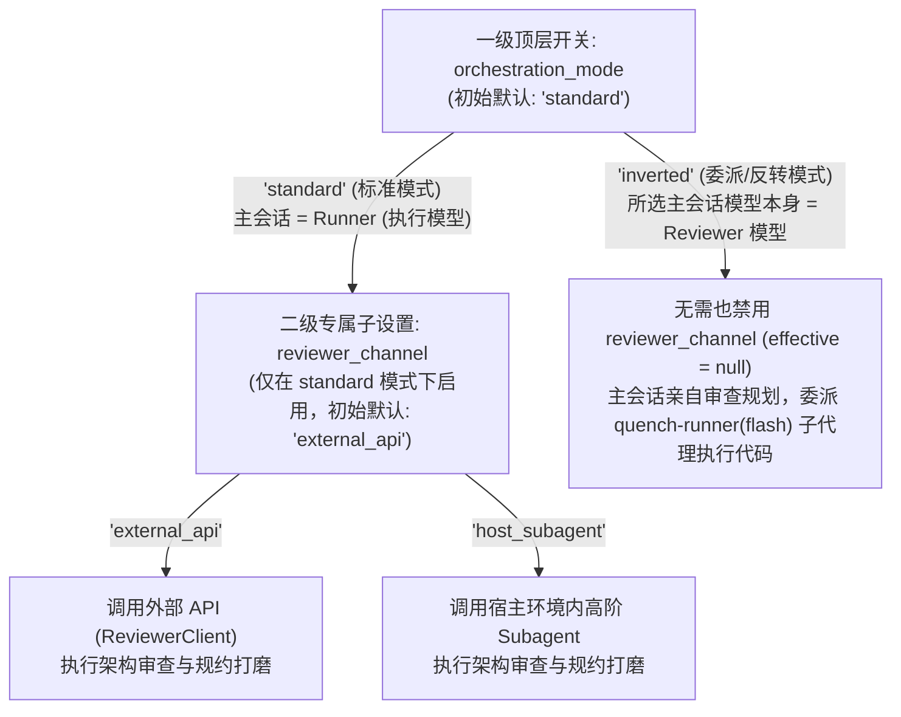
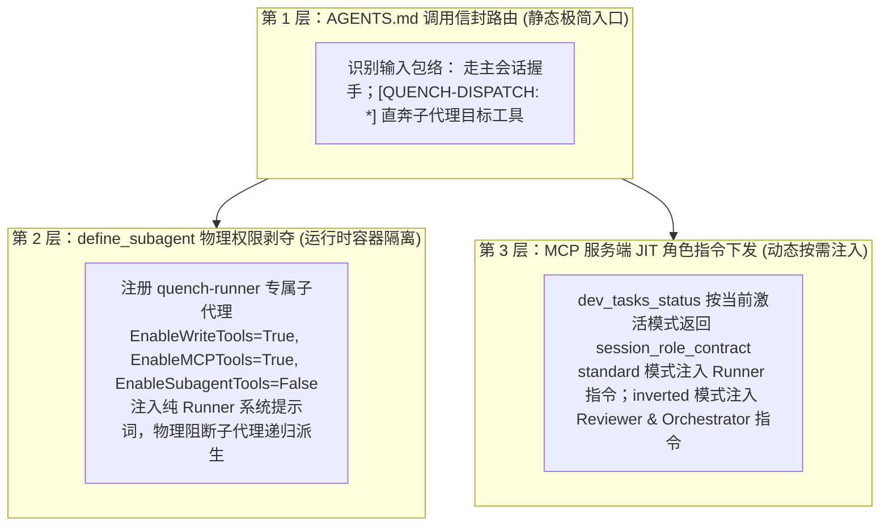

# Quench Dev-Orchestrator v1.25 双模编排拓扑、精益契约与全自动闭环工作流护栏 (Autopilot Harness) 路线图
> *(Dual-Mode Orchestration Topology, Lean Specification Contract & Batch Autopilot Workflow Harness Roadmap)*

> **Document Type**: Milestone Roadmap (Sub-charter for v1.25)  
> **Status**: 🟡 ACTIVE (In Planning / Architecture Finalized)  
> **Preceding Milestone**: [v1.24 原生心跳自刷新、长轮询降压与 Poll 极简瘦身路线图](./archive/v1.24_mcp_progress_heartbeat_and_poll_slimming_roadmap.md) (🟢 COMPLETED)  
> **Deferred Blueprint**: [Reviewer 轮询硬契约、状态栏扩展与跨宿主端侧可观测性蓝图](./plan_reviewer_polling_contract_and_cross_host_statusbar.md) (📋 PENDING)  
> **Scope**:
> 1. **双模编排与层级持久化切换（Epic 1）**：支持顶层编排模式 `standard`（标准模式：主会话敏捷执行 + 独立 Reviewer 审查）与 `inverted`（委派/反转模式：所选主会话模型本身即为 Reviewer 模型 + 宿主轻量 Subagent 执行）持久化切换；在 `standard` 模式下提供专属子设置 `reviewer_channel`（`external_api` 外部 API vs `host_subagent` 环境内高阶 Subagent，在 `inverted` 模式下不启用）；初始固定默认为 `standard` + `external_api`（无外部 API 时自动回退 `inverted`），支持用户通过自然语言指令触发持久化切换（`.agents/.quench_runtime_mode.json`）。
> 2. **三层上下文隔离与双层代码探查（Epic 2）**：统一确立“仅主会话调用 `dev_tasks_status`，所有 Subagent（无论执行、审查、探路）一律免调”铁律；通过调用信封路由、`define_subagent`（物理剥夺 `quench-runner` 递归派生权）与 MCP JIT 角色提示词下沉实现共用 `AGENTS.md` 下的第 0 秒隔离；固化 `inverted` 模式下“轻量 `research` 广度探路 + 主会话按行号切片精读”双层探查范式。
> 3. **精益任务单契约与审查边界重塑（Epic 3）**：收敛为单一统一六字段规范，精准摘除提示词中诱发过度设计的“无上限防御（No Upper Bounds）”与“无差别点名并发死锁/离线降级”指令，确立按上下文复杂度对齐原则；代码片段“免写样板、写了即用”，免除事后校验器对步骤长度或代码块的教条拦截。
> 4. **分批次 Autopilot 闭环工作流护栏与断点控制（Epic 4）**：在 MCP 工具链返回报文中内置 `harness_next_action` 状态机接力棒，进入正式流程后按批次自动闭环执行 `Propose -> Review -> Confirm -> Execute (Checkout..Complete) -> Sync Docs & Archive`（含 `inverted` 模式下 `verdicts.jsonl` 内生审查凭据自签发），并支持用户通过 `stop_at` 显式指令在任意阶段停靠验收。  
> **Explicit Non-Scope**: 破坏 16-tool 工具面数量不变量（严禁新增独立 MCP 工具，所有参数与状态均内聚于既有 `dev_tasks_*` 工具面）、引入任何硬编码模型名称或基于 `EFFORT LEVEL` 的隐式模型嗅探（严守 INV-5 厂商与模型中立）。  
> **Authority**: 遵循 v1.20 核心不可触碰清单与九大核心不变量（INV-1 ~ INV-9）；本文件为 v1.25 唯一路线图 SSOT。

---

## 0. 背景、痛点与演进动因（Verdict & Motivation）

在实际多模型协同开发中，开发者面临宿主能力边界、套餐额度调配与重复提示词心智负担三重挑战：

1. **宿主 Subagent 唤起方向的不对称性**：
   在当前 Antigravity 等宿主环境中，`invoke_subagent` 仅暴露 `["inherit", "flash_lite", "flash", "pro"]` 枚举。当以轻量敏捷模型（如 `3.8 Flash (Medium)`）作为主会话时，无法在宿主内部向上唤起旗舰架构模型（如 `4 Argon`）作为 Reviewer Subagent；若要同时使用宿主套餐内的 `4 Argon`（做架构审查）与 `3.8 Flash`（做代码执行）且避免手动切会话/切模型造成的缓存失效，必须支持将主从拓扑翻转——**由旗舰模型坐镇主会话担任 Reviewer & Orchestrator，向下唤起 `Model="flash"`（锁定 High 思考档位）作为执行 Subagent**。
2. **套餐额度与外部 API 的灵活调配诉求**：
   开发者常根据套餐内高阶模型余量在“标准模式（Flash 主会话 + 外部 API 审查）”与“委派模式（4 Argon 主会话 + Flash 子代理执行）”之间切换；同时未来宿主可能开放从 Flash 直接唤起环境内高阶模型作为 Reviewer Subagent。系统需提供**零隐式猜测、确定性初始默认、且可通过一句话持久化切换**的双维开关。
3. **Reviewer 模型的“过度设计”倾向**：
   现有 [`dev-tasks-review/SKILL.md`](../../plugins/quench-dev-tasks/skills/dev-tasks-review/SKILL.md)（`★ Rigidly Enforced, No Upper Bounds`）与 [`reviewer_engine.py`](../../plugins/quench-dev-tasks/server/reviewer_engine.py)（无差别要求排查并发死锁与离线降级）存在强诱导措辞，导致模型为简单改动凭空捏造并发锁、兜底分支与长篇样板代码。
4. **重复流程提示词的机械劳动**：
   在路线图敲定进入正式开发后，开发者往往需要在每轮提示词中重复手写*“生成任务单 -> 调 Reviewer 评估 -> 放行后确认 -> 执行开发 -> 更新相关文件并归档”*。由于现有 MCP 工具仅返回静态成功消息而非状态机下一步接力指令，模型每走一步就会停机等待，亟需内建 **Autopilot Workflow Harness（状态机接力棒护栏）**。

---

## 1. Epic 1：双模编排拓扑与主从层级持久化切换（Dual-Mode Orchestration & Hierarchical Persistent Toggles）

### 1.1 顶层编排模式与 `standard` 专属审查通道（主从层级结构）

摒弃任何复杂的“未锁定初始猜测”或破坏 `INV-5` 的模型特征嗅探，采用**“一级编排模式 + 标准模式专属二级审查通道”**的清晰主从层级结构：



| 层级与归属 | 配置/状态键 | 可选枚举值 | 初始默认值 | 激活条件与语义定义 |
| :--- | :--- | :--- | :---: | :--- |
| **一级开关：主从编排模式** | `orchestration_mode` | `"standard"` \| `"inverted"` | **`"standard"`** | **全局生效**：<br>• **`standard`（标准模式）**：主会话模型担任 **Runner（敏捷执行者）**；架构审查交由下级子设置 `reviewer_channel` 指定的审查端完成，主会话直接调用 `dev_tasks_checkout` 编码跑测。<br>• **`inverted`（委派/反转模式）**：**用户在宿主中选择的主会话模型本身就是 Reviewer 模型**；主会话亲自负责架构把关与任务确认（**不启用 `reviewer_channel`**），代码执行与测试通过 `invoke_subagent(TypeName="quench-runner", Model="flash")` 委派给执行子代理。 |
| **二级子设置：标准模式审查通道** | `reviewer_channel` | `"external_api"` \| `"host_subagent"` | **`"external_api"`** | **仅当 `orchestration_mode == "standard"` 时启用**（在 `"inverted"` 模式下自动挂起失效，返回报文 `effective_reviewer_channel = None`）：<br>• **`external_api`（外部 API 通道）**：通过 `ReviewerClient` 调用外部 OpenAI 兼容 API（`dev_reviewer_submit` / `dev_reviewer_poll` / `dev_tasks_refine_spec`）。<br>• **`host_subagent`（环境内高阶模型通道）**：不调用外部 API，而是通过 `invoke_subagent(TypeName="reviewer", ...)` 唤起宿主环境内的高阶模型完成只读审查与规约打磨。 |

> **无外部 API 时的自动安全回退（Auto-Fallback on Missing External API）**：  
> 当处于默认的 `orchestration_mode="standard"` 且 `reviewer_channel="external_api"`，但检测到本机未配置可用外部 API（`provider == "none"` 或环境变量中未设置对应 API Key）时，`dev_tasks_status` 自动将当前有效编排模式回退为 **`"inverted"`（委派模式，由当前主会话模型直接担任 Reviewer）**，确保开箱即用不断流。

### 1.2 用户输入驱动的跨会话持久化切换（`.agents/.quench_runtime_mode.json`）

为了支持开发者根据套餐余量或使用习惯随时切换，且对长期固定单一模式的用户保持“设定一次、永久免管”的体验：

1. **持久化状态文件**：在 `.agents/.quench_runtime_mode.json`（受 `.gitignore` 忽略，不污染版本库）中持久化存储：
   ```json
   {
     "orchestration_mode": "standard",
     "reviewer_channel": "external_api",
     "updated_at": "2026-10-23T10:00:00Z"
   }
   ```
   *(注：当 `orchestration_mode` 切换为 `"inverted"` 时，`dev_tasks_status` 返回的运行时快照中 `effective_reviewer_channel` 固定为 `None`，明确标识当前由主会话模型自身担任 Reviewer，避免任何通道混淆。)*
2. **`dev_tasks_status` 切换接口扩展**（不新增独立 MCP 工具，保持 16-tool 表面恒定）：
   在 `dev_tasks_status` 中新增可选参数：
   - `switch_mode: Optional[Literal["standard", "inverted"]] = None`
   - `switch_reviewer_channel: Optional[Literal["external_api", "host_subagent"]] = None`（仅针对 `standard` 模式的审查通道子设置生效）
3. **交互体验**：
   - 初始固定默认为 `standard` 模式 + `external_api` 审查通道；
   - 当用户在对话中输入*“切到委派模式/反转模式”*或*“切回标准模式”*（或在标准模式下说*“审查切到环境内模型/外部 API”*）时，主会话在调用 `dev_tasks_status` 时传入对应参数，服务端原子更新 `.agents/.quench_runtime_mode.json` 并立即按新模式返回 `session_role_contract`。此后所有新建会话均沿用该持久化状态，直至用户下次主动切换。

---

## 2. Epic 2：三层上下文隔离、主会话专属握手与双层代码探查（Context Isolation & Reconnaissance）

### 2.1 统一启动握手铁律：仅主会话调用 `dev_tasks_status`

无论当前运行在 `standard` 还是 `inverted` 模式，**`dev_tasks_status` 严格限定为主会话（Main Session）专属的启动握手工具**；任何被 `invoke_subagent` 唤起的子代理一律免调 `dev_tasks_status`：

| 会话/代理类型 | 输入消息包络特征 | 启动首步行为 | 是否调用 `dev_tasks_status` |
| :--- | :--- | :--- | :---: |
| **主会话 (Main Session)** | 接收人类用户 `<USER_REQUEST>` | 会话启动或正式流程开启时调用 `dev_tasks_status`，获取队列状态、当前模式身份卡（`session_role_contract`）与 `harness_next_action` | **✅ 必须调用** |
| **执行子代理 (`quench-runner`)** | 首条消息含 `[QUENCH-DISPATCH: RUNNER]` | 直接按派单指定的 `task_file` 与 `task_id` 调用 `dev_tasks_checkout` -> 编码跑测 -> `dev_tasks_complete` -> 返回 ≤5 行 C3 交付卡 | **❌ 严禁调用** |
| **审查子代理 (`reviewer`)** | 首条消息含 `[QUENCH-DISPATCH: REVIEWER]` | 直接针对派单传入的任务草案与代码切片执行只读审查并返回六字段规约 | **❌ 严禁调用** |
| **探路子代理 (`research`)** | 首条消息含 `[QUENCH-DISPATCH: RESEARCH]` | 直接执行 `grep_search` / `read_file` 并返回高密度符号与行号索引 | **❌ 严禁调用** |

### 2.2 共用 `AGENTS.md` 下的三层第 0 秒提示词隔离

为彻底解决主从模型共用同一份 [`AGENTS.md`](../../AGENTS.md) 时的角色串戏问题（避免 `inverted` 主会话误调 `checkout` 自己写代码，或子代理递归派生子代理），实施三层隔离：



### 2.3 `inverted` 模式下的双层代码探查范式（Two-Tier Code Reconnaissance）

在 `inverted` 模式下，高阶模型（如 `4 Argon`）坐镇主会话。为同时保证**架构设计方向 100% 准确**与**高阶模型上下文低开销**，确立以下双层探查流程：

1. **第 1 层：广度检索外包（Flash `research` Subagent / AST 切片）**
   - 当需要跨目录定位调用链、查找配置消费点或摸清模块拓扑时，主会话**禁止**对未知大文件连续执行全文 `read_file`；
   - 主会话唤起 `invoke_subagent(TypeName="research", Model="flash", Prompt="[QUENCH-DISPATCH: RESEARCH] ...")`（或复用 AST 切片定位），令轻量模型替主会话阅读全量候选文件，仅向主会话返回**《紧凑代码探查简报（≤150 行）》**：包含精确文件路径、关键函数/类签名、核心逻辑所在的精确行号区间 `[StartLine, EndLine]` 及调用依赖关系。
2. **第 2 层：深度靶向精读（主会话按行切片读取）**
   - 主会话根据探查简报给出的行号区间，调用 `read_file(Path=..., StartLine=..., EndLine=...)` 亲自精读需要修改的那 50~150 行真实源码切片，据此制定准确的 `type_contracts` 与 `steps`。

---

## 3. Epic 3：精益任务单契约与审查职责边界重塑（Lean Spec Contract & Anti-Overengineering）

### 3.1 统一一套任务单标准，摘除“强制加戏”诱导源

不拆分两套不同粒度的任务单机制，统一收敛为一套**“重接口契约与测试断言、轻样板过程代写”**的六大核心字段规范。针对 Reviewer 模型常见的过度设计倾向，直接清理现有提示词中的三大诱导病灶：

1. **清理 [`dev-tasks-review/SKILL.md`](../../plugins/quench-dev-tasks/skills/dev-tasks-review/SKILL.md)**：
   - 移除第 2 节质量分级表中 `1. Defensive & Edge Checks —— ★ Rigidly Enforced, No Upper Bounds（严格强制，无上限）` 的表述；
   - 替换为**上下文成比例原则（Context-Proportional Defense）**：防御与边缘校验仅针对本次改动真实触及的输入边界与状态转换；除非目标模块本身处于跨进程/多线程/外部网络 I/O 路径，**严禁凭空要求引入需求之外的并发锁、缓存层、重试队列或离线降级开关**。
2. **清理 [`reviewer_engine.py`](../../plugins/quench-dev-tasks/server/reviewer_engine.py)（`PromptAssembler`）与 [`server.py`](../../plugins/quench-dev-tasks/server/server.py)（`dev_tasks_refine_spec`）**：
   - 将原系统提示词中不分场景点名要求排查 `concurrency deadlocks, boundary overflows, and offline fallbacks` 及 `ironclad` 的强诱导指令，修正为**“精准识别客观缺陷、保持最小改动表面积（Minimal Diff Surface）、契约与测试优先”**。
3. **代码片段“免写样板、写了即用”，免除事后死板校验拦截**：
   - 提示词明确引导 Reviewer 在 `steps` 中聚焦**修改意图与符号锚点**，无需预先默写常规样板代码（boilerplate）；
   - **不在 [`schema_validator.py`](../../plugins/quench-dev-tasks/server/schema_validator.py) 中增加任何事后步骤数量、行数或代码块封杀拦截**——若高阶模型在推演复杂逻辑时已顺手写出关键代码片段，直接保留供 Runner 复用，绝不事后报错重跑而浪费已消耗的高阶模型 Token。

---

## 4. Epic 4：分批次全自动闭环工作流护栏与断点控制（Batch Autopilot Workflow Harness）

### 4.1 双阶段研发节奏：前期交互磨路线图 vs 正式流程分批 Autopilot

将完整研发周期划分为界限分明的两个阶段：

1. **阶段 A：需求打磨与路线图敲定阶段（Interactive Roadmap Refinement）**
   - 开发者与模型围绕需求细节、架构权衡与阶段批次（Batch / Stage）划分进行多轮探讨，产出并锁定 `docs/roadmap/v1.xx_*.md`；
   - 此阶段属于非受管文档研讨（`docs/**`），**不提前触发** `dev_tasks_propose` 流水线。
2. **阶段 B：正式流程分批次全自动闭环（Batch Autopilot Execution）**
   - 当路线图敲定、开发者下达启动正式流程指令（如*“开始正式流程”*或*“按路线图第一批次开始执行”*）后，系统无需开发者再手写*“生成任务单 -> 调 Reviewer 评估 -> 确认 -> 开发 -> 更新文档并归档”*的长串提示词，由 **MCP 状态机接力棒（`harness_next_action`）** 自动驱动当前批次跑完全程，并支持按用户显式指令在指定断点停靠验收。

### 4.2 服务端状态机接力棒（`harness_next_action`）与断点控制（`stop_at`）

在 `dev_tasks_status`、`dev_tasks_propose`、`dev_tasks_refine_spec`、`dev_reviewer_poll`、`dev_tasks_confirm`、`dev_tasks_complete`、`dev_tasks_archive` 的返回字典中统一注入结构化字段 `harness_next_action`：

```mermaid
flowchart TD
    Start["正式流程启动 (指定批次 Batch N, 可选 stop_at 断点)"] --> Step1["1. 生成任务单: dev_tasks_propose"]
    
    Step1 --> CheckBP1{"stop_at == 'after_propose'?"}
    CheckBP1 -->|是| Pause1["⏸️ 停靠等待用户验收任务草案"]
    CheckBP1 -->|否 (自动接力)| Step2{"2. Reviewer 评估放行"}
    
    Step2 -->|standard + external_api| R_Ext["调用 dev_tasks_refine_spec / submit+poll"]
    Step2 -->|standard + host_subagent| R_Sub["调用 reviewer Subagent 评估修订"]
    Step2 -->|inverted (主会话即Reviewer)| R_Inv["主会话完成物理可行性自审并签发内生审计凭据"]
    
    R_Ext --> CheckBP2{"stop_at == 'after_review'?"}
    R_Sub --> CheckBP2
    R_Inv --> CheckBP2
    
    CheckBP2 -->|是| Pause2["⏸️ 停靠等待用户审阅评估结果"]
    CheckBP2 -->|否 (评估通过, 自动接力)| Step3["3. 放行确认: dev_tasks_confirm(action='confirm')"]
    
    Step3 --> CheckBP3{"stop_at == 'after_confirm'?"}
    CheckBP3 -->|是| Pause3["⏸️ 停靠等待用户确认后开工"]
    CheckBP3 -->|否 (自动接力)| Step4{"4. 循环执行批次内已确认任务"}
    
    Step4 -->|standard 模式| E_Std["主会话循环: checkout -> 编码跑测 -> complete"]
    Step4 -->|inverted 模式| E_Inv["主会话循环派发 quench-runner(flash) 子代理:<br/>checkout -> 编码跑测 -> complete"]
    
    E_Std --> AllDone{"本批次任务全部 ✔️ 已完成?"}
    E_Inv --> AllDone
    AllDone -->|否 (仍有 ✅ 已确认)| Step4
    AllDone -->|是| CheckBP4{"stop_at == 'before_archive'?"}
    
    CheckBP4 -->|是| Pause4["⏸️ 停靠等待用户验收代码与测试"]
    CheckBP4 -->|否 (自动接力)| Step5["5. 收尾闭环: 同步更新关联路线图/文档<br/>并调用 dev_tasks_archive 归档 + 更新 CHANGELOG"]
    Step5 --> NextBatch["汇报本批次交付汇总 / 进入下一批次"]
```

#### 关键机制细节：
1. **可配置断点参数（`stop_at`）**：
   - 支持枚举值：`"none"`（**默认**，全自动跑完当前批次直至文档更新与归档）、`"after_propose"`、`"after_review"`、`"after_confirm"`、`"before_archive"`。
   - 断点状态可通过 `dev_tasks_status` 或 `dev_tasks_propose` 传入并记录在当前会话运行时状态中；一旦抵达目标节点，`harness_next_action` 返回 `{"action": "PAUSE_FOR_ACCEPTANCE", "stage": "<stop_at>", "instruction": "..."}`，模型立即停机汇报并等待用户确认后继续。
2. **`inverted` 模式下的 Pre-Confirm 审计门禁自签发（Self-Attested Verdict in Inverted Mode）**：
   - 在 `standard` 模式下，`audit_gate` 校验 `.agents/logs/reviewer/verdicts.jsonl` 中由外部 API 写入的审查记录；
   - 在 `inverted` 模式下，由于主会话自身即为高阶 Reviewer（不调用外部 API），当主会话在 `inverted` 模式下执行 `dev_tasks_propose` / `dev_tasks_confirm` 且通过 `lint_task_physical_feasibility` 物理可行性校验时，服务端自动向 `verdicts.jsonl` 追加一条 `source="inverted_main_reviewer"` 的合规审计快照，使其无缝通过 `audit_gate` 门禁。

---

## 5. 分阶段实施计划与任务批次划分（Staged Implementation Plan）

本路线图划分为 **3 个递进施工批次（Batches）**，完全遵循正式流程分批推进：

### 第一批次（Batch 1）：运行时双模状态管理、审计门禁自签发与服务端 `harness_next_action` 接力引擎
- **任务 25.1 ⬜ 待规划 — 持久化双模状态机（`.quench_runtime_mode.json`）与 `dev_tasks_status` 热切换及角色契约下发**
  - **【涉及文件】**：
    - `[MODIFY] plugins/quench-dev-tasks/server/project_config.py`
    - `[MODIFY] plugins/quench-dev-tasks/server/server.py`
    - `[NEW] plugins/quench-dev-tasks/server/tests/test_dual_mode_runtime_switch.py`
  - **【核心目标】**：实现顶层 `orchestration_mode`（默认 `"standard"`）及其在 `"standard"` 模式下的专属子设置 `reviewer_channel`（默认 `"external_api"`，在 `"inverted"` 模式下自动挂起失效、`effective_reviewer_channel = None`，因委派模式下主会话模型自身即为 Reviewer）的持久化读写与无外部 API 自动回退 `"inverted"` 逻辑；在 `dev_tasks_status` 中支持 `switch_mode`、`switch_reviewer_channel` 与 `stop_at` 参数，并在返回报文中动态生成 `session_role_contract`。
- **任务 25.2 ⬜ 待规划 — Autopilot `harness_next_action` 接力棒引擎、断点停靠与 `inverted` 模式审计门禁自签发**
  - **【涉及文件】**：
    - `[MODIFY] plugins/quench-dev-tasks/server/server.py`
    - `[MODIFY] plugins/quench-dev-tasks/server/pre_confirm_gate.py`
    - `[NEW] plugins/quench-dev-tasks/server/tests/test_autopilot_harness_baton.py`
  - **【核心目标】**：在 `propose` -> `refine_spec`/`poll` -> `confirm` -> `checkout` -> `complete` -> `archive` 全链路返回字典中注入确定性的 `harness_next_action` 状态机接力棒与 `stop_at` 断点拦截；打通 `inverted` 模式下 `verdicts.jsonl` 的 `inverted_main_reviewer` 自动签发与 `pre_confirm_gate` 放行。

### 第二批次（Batch 2）：精益审查提示词重塑（去过度设计诱导源）与三层提示词隔离落地
- **任务 25.3 ⬜ 待规划 — 审查引擎与 Skill 提示词去诱导化（摘除无上限防御与无差别并发/降级强迫指令）**
  - **【涉及文件】**：
    - `[MODIFY] plugins/quench-dev-tasks/server/reviewer_engine.py`
    - `[MODIFY] plugins/quench-dev-tasks/server/server.py`
    - `[MODIFY] plugins/quench-dev-tasks/skills/dev-tasks-review/SKILL.md`
    - `[MODIFY] plugins/quench-dev-tasks/server/tests/test_reviewer_prompt_contract.py`
  - **【核心目标】**：清理 `PromptAssembler`、`dev_tasks_refine_spec` 及 `dev-tasks-review/SKILL.md` 中的 `No Upper Bounds`、`concurrency deadlocks / offline fallbacks` 无差别诱导词，确立按上下文复杂度对齐（Context-Proportional）与代码片段“免写样板、写了即用”原则。
- **任务 25.4 ⬜ 待规划 — `AGENTS.md`、工作流 Skill 与纪律规范的三层隔离、双层探查及 Autopilot 闭环契约升级**
  - **【涉及文件】**：
    - `[MODIFY] AGENTS.md`
    - `[MODIFY] plugins/quench-dev-tasks/skills/dev-tasks-workflow/SKILL.md`
    - `[MODIFY] plugins/quench-dev-tasks/rules/dev-tasks-discipline.md`
    - `[MODIFY] plugins/quench-dev-tasks/agents/reviewer/agent.md`
  - **【核心目标】**：同步更新入口卡与技能文档：(1) 确立“仅主会话调用 `dev_tasks_status`，所有 Subagent 免调”铁律；(2) 固化 `[QUENCH-DISPATCH: RUNNER | REVIEWER | RESEARCH]` 信封路由与 `quench-runner`（`EnableSubagentTools=False`）定义模板；(3) 写入 `inverted` 模式双层代码探查流程与 Autopilot 接力棒执行纪律。

### 第三批次（Batch 3）：架构主文档、MCP 规格说明书与契约回归测试全量同步
- **任务 25.5 ⬜ 待规划 — 架构规范（`docs/architecture/README.md`）与 MCP 协议规格（`dev_tasks_mcp_specification.md`）同步及全量测试收口**
  - **【涉及文件】**：
    - `[MODIFY] docs/architecture/README.md`
    - `[MODIFY] dev_tasks_mcp_specification.md`
    - `[MODIFY] docs/configuration.md`
    - `[MODIFY] plugins/quench-dev-tasks/server/tests/test_architecture_doc_anchor_integrity.py`
  - **【核心目标】**：将双模编排拓扑、双维持久化切换、子代理免调 `status` 协议及 Autopilot Harness 接力棒规范同步至架构 SSOT 文档与规格说明书，确保全量 pytest 测试套件 100% 绿灯通过。

---

<<<TASK_DRAFT>>>
（路线图已就绪，待用户确认后按批次进入正式 Autopilot 施工流程）
<<<END>>>
